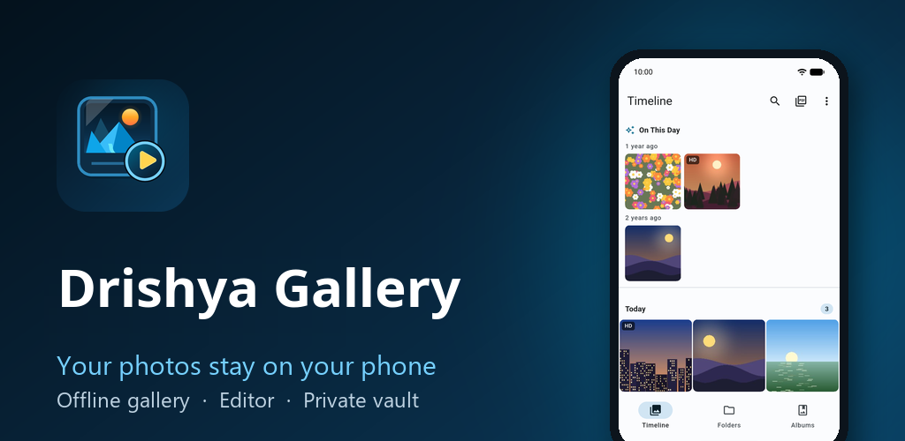
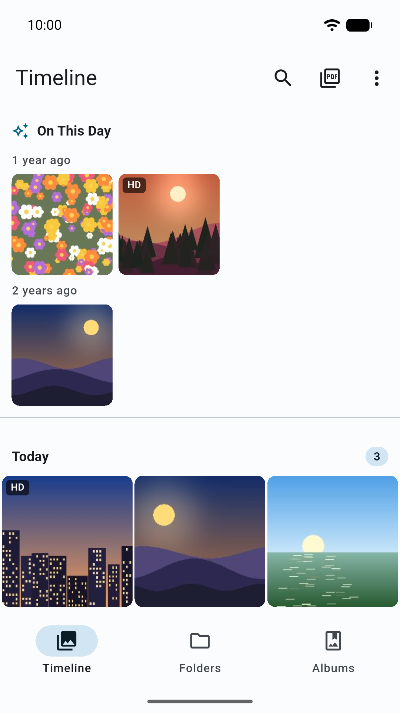
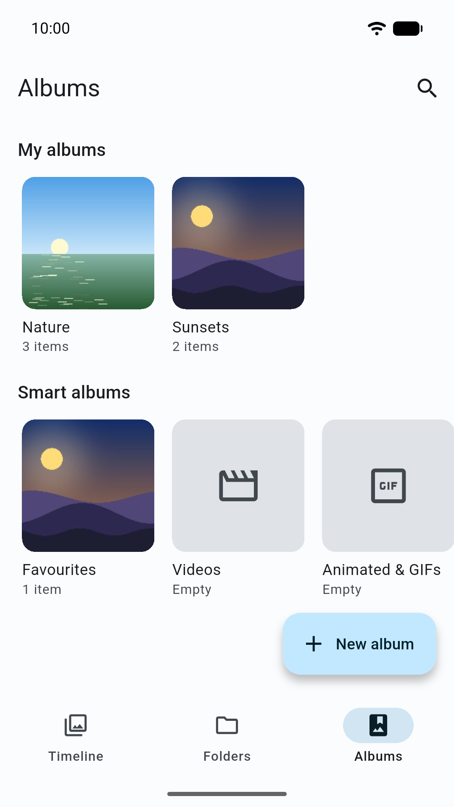
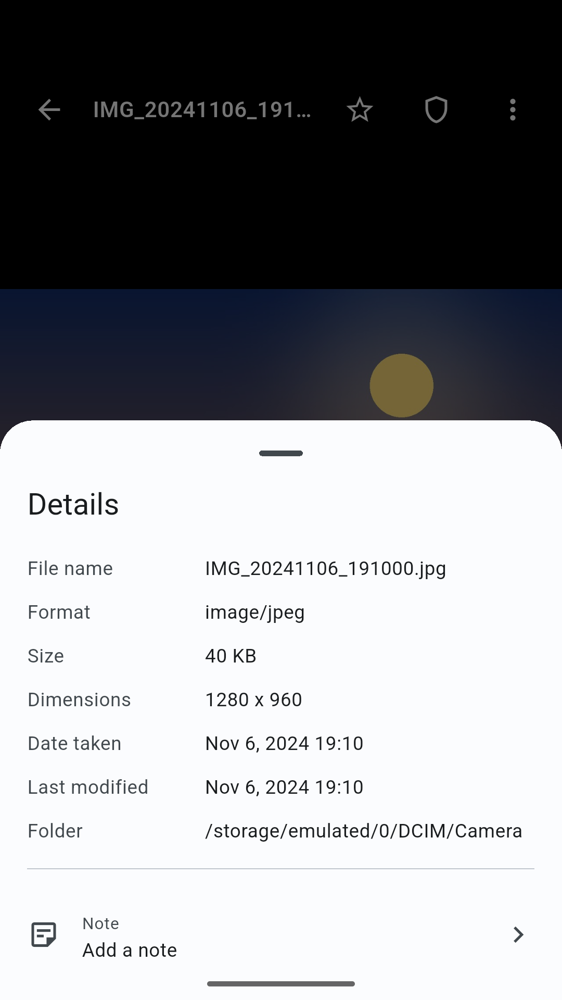
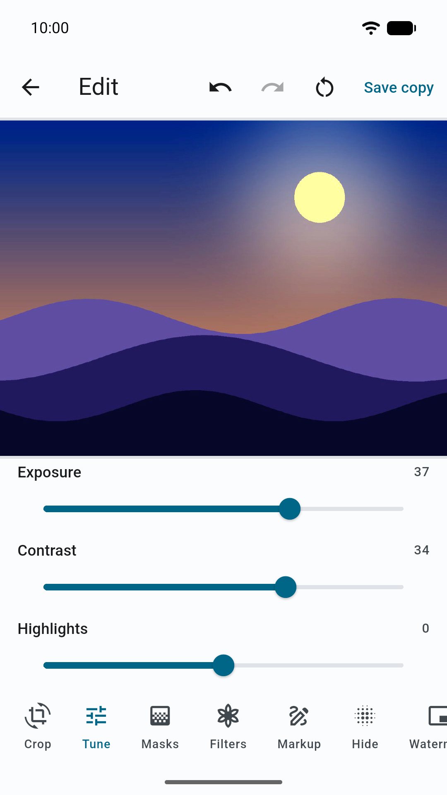
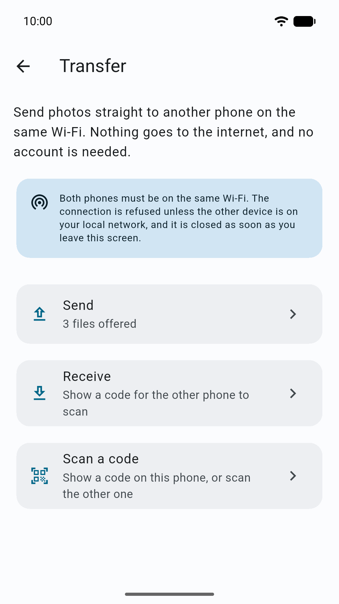
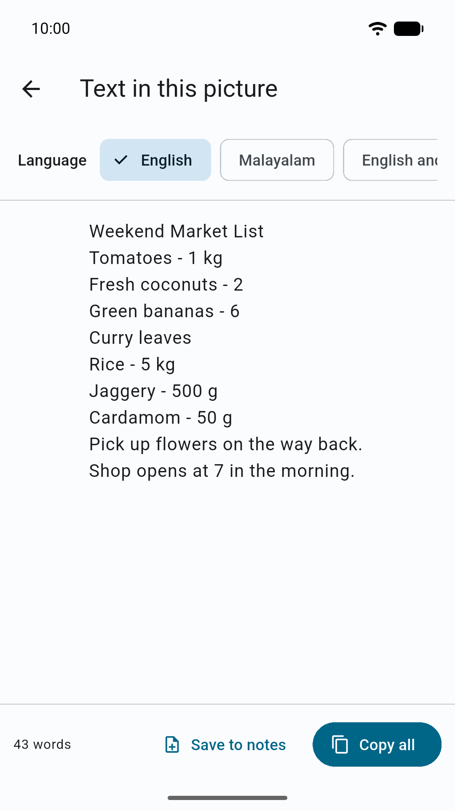
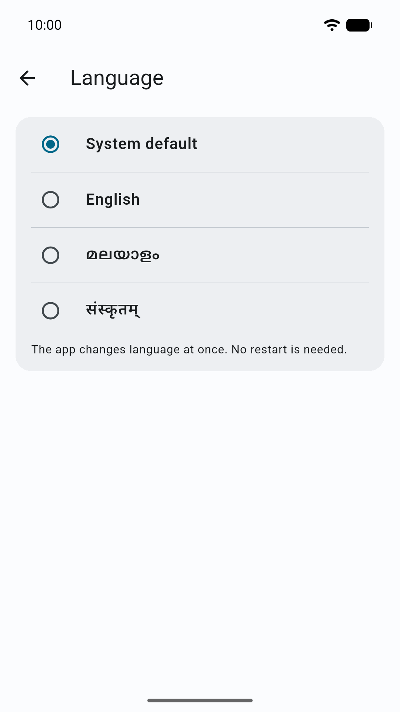

<p align="center">
  
</p>

# Drishya Gallery

*Formerly "SreerajP Image Video Gallery". In Malayalam the app is called ദൃശ്യ, and in Sanskrit
दृश्य ("that which is seen").*

An offline gallery for Android. It shows, organises and edits the photos and videos on your phone,
and keeps private pictures in an encrypted vault. Everything happens on the phone itself: there is
no account, no cloud and no tracking.


[](LICENSE)

## Why This App

- **Offline:** the app never talks to a server. No cloud backend, no update check.
- **No account:** there is nothing to sign up for.
- **No tracking:** no analytics, ads or crash reporting.
- **Safe edits:** edits are saved as a new copy; your original is never overwritten.
- **Private vault:** pictures you move into it are encrypted with AES-256-GCM.
- **Phone to phone:** send pictures to another phone on the same Wi-Fi, with no server in between.
- **Open source:** MIT licence, built only with open source packages.

## Screenshots

<table>
  <tr>
    <td></td>
    <td></td>
    <td></td>
    <td></td>
  </tr>
  <tr>
    <td></td>
    <td></td>
    <td></td>
    <td></td>
  </tr>
</table>

All pictures in the screenshots are made up. There is no screenshot of the vault: it blocks
screenshots and screen recording on purpose.

## Features

### Browse Your Library

- A timeline of all your photos and videos, grouped by date
- On This Day: pictures from the same date in past years
- Pinch to change the grid size, and a fast scroller for big libraries
- Opens JPEG, PNG, WebP, BMP, HEIC/HEIF, AVIF, GIF, SVG and more, with previews for RAW photos (DNG, CR2, NEF, ARW)
- A video player with speed control, frame stepping and gesture controls
- Full details of each picture: file, size, date, and camera and place when the picture holds them
- Can be set as the phone's default app for opening pictures and videos

### Organise

- Albums that do not move or copy your files
- Device folders and smart albums: favourites, videos, animated and GIFs, and more
- Tags with colours, and notes on any photo or video
- Search by name, tag, album, note, camera or place
- Find exact and similar duplicates, compare them side by side, and clean up
- Deleted items go to a trash first, so you can change your mind

### Edit Without Fear

- Crop, rotate, straighten and correct perspective
- Light and colour: exposure, contrast, highlights, shadows, warmth, curves and more
- Filters, drawing, shapes, text and watermarks
- Blur, pixelate or black out faces and private details
- Edits are saved as a new copy; the original stays untouched

### Convert And Export

- Convert and resize images to JPEG, PNG, WebP or BMP
- Make a PDF from your photos, or take the images out of a PDF
- Video tools: trim a clip, save a frame as a picture, or make a GIF

### Text And Codes In Pictures

- Read text from a photo, offline, in English and Malayalam (bundled Tesseract data)
- Read QR codes and barcodes inside your pictures

### Private Vault

- Move private photos and videos into a vault locked by a PIN, with optional fingerprint unlock
- Files are encrypted with AES-256-GCM; the key is kept in the Android Keystore
- Screenshots are blocked inside the vault, and it locks itself when you leave
- **There is no way to recover a forgotten vault PIN.** Uninstalling the app also removes the
  vault's key, so restore your pictures from the vault first

### Transfer And Backup

- Send photos and videos to another phone on the same Wi-Fi, paired by scanning or typing a code
- The transfer is encrypted and goes directly between the two phones
- Back up albums, tags, notes and favourites to one password-protected `.gallerybak` file

### Look And Language

- English, Malayalam (മലയാളം) and Sanskrit (संस्कृतम्), changed in Settings without a restart
- System, light and dark themes

The full product concept is in [docs/Project_Idea.md](docs/Project_Idea.md).

## Availability

The app needs Android 7.0 (API 24) or newer. A Google Play release is planned, starting with
closed testing. Signed split APKs (one per CPU type) are also planned for direct download. Until
then, you can build it from source with the steps below.

## Privacy And Permissions

The app collects nothing and sends nothing to any server. Your index of pictures, albums, tags,
notes and settings stay in the app's private storage on your phone. Android cloud backup and
device-to-device copying of app data are turned off.

**Local network only.** The internet permission exists for one feature, phone-to-phone transfer,
because Android needs it for any network connection, even one to a phone on the same router. The
app refuses every address that is not a private local one, listens only on the phone's own Wi-Fi
address, and only while the transfer screen is open.

| Permission | Why it is needed |
|---|---|
| Photos and videos (`READ_MEDIA_IMAGES`, `READ_MEDIA_VIDEO`, `READ_MEDIA_VISUAL_USER_SELECTED`; `READ_EXTERNAL_STORAGE` on Android 12 and older) | To show and organise your media. With "limited access", the app shows only the pictures you picked |
| Biometric (`USE_BIOMETRIC`, `USE_FINGERPRINT` on Android 9 and older) | Optional fingerprint unlock for the vault. The PIN always works |
| Camera | Only to scan the pairing code on the transfer screen. The app never takes photos. Optional: you can type the code instead |
| Internet, Wi-Fi state, network state | Only for phone-to-phone transfer on your local Wi-Fi |
| Change Wi-Fi state | Only to offer a Wi-Fi network from a scanned QR code to Android, which still asks you to confirm |

More detail: [PRIVACY.md](PRIVACY.md) and [docs/security.md](docs/security.md) (§11 lists every
permission).

---

## For Developers

### Prerequisites

| Component | Version |
|---|---|
| Flutter SDK | **3.47.6** (stable), the version the project and CI build with. Lowest allowed: 3.41.0 |
| Dart SDK | **3.13.5** (ships with Flutter 3.47.6). Lowest allowed: 3.11.0 |
| Platform | Android only |
| Android `minSdk` / `targetSdk` / `compileSdk` | 24 / 36 / 36 |
| JDK | 17 |

### Get The Code

The shared guidelines live in a git submodule (`docs/guidelines`), so clone with it:

```bash
git clone --recurse-submodules https://github.com/sreerajp80/SreerajP_Image_Video_Gallery.git
```

In an existing clone, fetch the submodule:

```bash
git submodule update --init
```

Then install the packages and generate the localization files:

```bash
flutter pub get
flutter gen-l10n
```

**Code generation.** `flutter gen-l10n` is the only generator you run by hand; run it after any
`.arb` change. The project does not use `build_runner`. The files
`lib/core/constants/app_version.g.dart` and `lib/core/constants/build_date.g.dart` are written by
a Gradle task (from `tool/`) during every Android build. Never edit them.

**Environment values.** No `--dart-define` values are needed. The flavor is set by `--flavor`,
which Flutter passes to the app as `FLUTTER_APP_FLAVOR`.

### Run

The project has two build flavors. A bare `flutter run` fails, so always pass `--flavor`:

| Flavor | App ID | Name on the phone |
|---|---|---|
| `dev` | `in.sreerajp.imgvidgal.dev` | Drishya Gallery Dev |
| `prod` | `in.sreerajp.imgvidgal` | Drishya Gallery |

```bash
flutter run --flavor dev
```

```bash
flutter run --flavor prod
```

### Code Quality And Tests

Every change must pass these before it is committed:

```bash
flutter analyze
```

```bash
flutter test
```

```bash
dart format .
```

GitHub CI runs the same checks. It never builds, signs or publishes a release.

### Release Builds

Release builds are made locally, never in CI. They use `--release`, `--obfuscate` and
`--split-debug-info`. Signing settings are read from `android/key.properties`, which points to the
release keystore. Both are git-ignored and never committed. The full steps are in
[docs/release_process.md](docs/release_process.md).

**Split APKs** (direct download), one per CPU type (`arm64-v8a`, `armeabi-v7a`, `x86_64`):

```bash
flutter build apk --flavor prod --release \
  --obfuscate --split-debug-info=build/symbols/android-prod-<version>/ \
  --split-per-abi
```

```powershell
flutter build apk `
  --flavor prod `
  --release `
  --obfuscate `
  --split-debug-info=build/symbols/android-prod-<version>/ `
  --split-per-abi
```

**App Bundle** (Google Play):

```bash
flutter build appbundle --flavor prod --release \
  --obfuscate --split-debug-info=build/symbols/android-prod-<version>/
```

```powershell
flutter build appbundle `
  --flavor prod `
  --release `
  --obfuscate `
  --split-debug-info=build/symbols/android-prod-<version>/
```

After a build, stop the Gradle daemons so they do not hold memory:

```bash
android/gradlew --stop
```

### Database Migrations

The local index and search database uses SQLite through `sqflite`.

- Table names and the schema version are in `lib/repositories/database/database_constants.dart`.
- The connection, lifecycle and migrations are in `lib/repositories/database/database_helper.dart`.

To add a migration:

1. Increase `DatabaseConstants.schemaVersion`.
2. Add a migration method in `DatabaseHelper` (for example `_migrateToV6(Database db)` when the current version is 5).
3. Call it from `_onUpgrade` for the new version.
4. Add a test in `test/repositories/database/database_migration_test.dart` that builds the
   previous schema by hand, upgrades it and checks the result. Never change a migration that has
   already shipped; add a new one.

### Documentation

| Document | Purpose |
|---|---|
| [AGENTS.md](AGENTS.md) / [CLAUDE.md](CLAUDE.md) | Rules for AI agents working on the project |
| [PRIVACY.md](PRIVACY.md) | Privacy policy |
| [docs/PROJECT_PROFILE.md](docs/PROJECT_PROFILE.md) | Platforms, stores, languages and About-screen options |
| [docs/architecture.md](docs/architecture.md) | Layers, state management, models and services |
| [docs/security.md](docs/security.md) | Threat model, local network rules, vault encryption, permissions |
| [docs/release_process.md](docs/release_process.md) | Release steps and checklist |
| [docs/dependencies.md](docs/dependencies.md) | Packages used, and the blocked-package policy |
| [docs/project_structure.md](docs/project_structure.md) | Folder layout and what each part does |
| [docs/workflow_rules.md](docs/workflow_rules.md) | Plan-before-changing and log-after-changing rules |
| [docs/known_gaps.md](docs/known_gaps.md) | Guideline rules the app does not meet yet |
| [docs/Project_Idea.md](docs/Project_Idea.md) | Product concept and feature list |
| [docs/implementation_plan.md](docs/implementation_plan.md) / [docs/implementation_progress.md](docs/implementation_progress.md) | Phase plan and progress record |
| [docs/feature_improvements_and_standout_features.md](docs/feature_improvements_and_standout_features.md) | Feature review and ideas |
| [docs/GUIDELINES_MANIFEST.md](docs/GUIDELINES_MANIFEST.md) | Index of the shared Flutter guidelines in `docs/guidelines/` |

## Licence

MIT. See [LICENSE](LICENSE). © 2026 Sreeraj P.

Contact: sreerajp@zohomail.in
